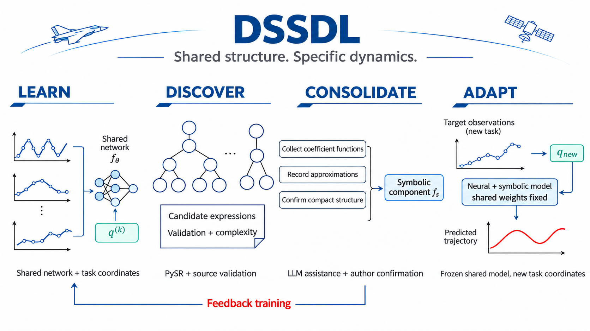

# DSSDL
### Disentangled Shared-Specific Dynamics Learning for Cross-System Identification


**Shared structure. Specific dynamics.**

A research codebase for learning shared dynamics across related systems, adapting
low-dimensional task coordinates from limited observations, and studying symbolic
discovery with feedback training.

[Getting started / 使用指南](GETTING_STARTED.md) ·
[Project page source](docs/index.html) ·
[Experiment map](revision_2026_11/EXPERIMENTS.md) ·
[Contributing](CONTRIBUTING.md)

## Start here

Python 3.10 or 3.11 is recommended for the recorded scientific environment.

```bash
git clone https://github.com/PaoShou-China/DSSDL.git
cd DSSDL
python -m pip install -e ".[experiments]"
dssdl doctor
dssdl verify
```

Use a virtual environment. For a specific CPU/CUDA build, install PyTorch first
using its [official instructions](https://pytorch.org/get-started/locally/).
The lightweight `pip install -e .` installs the CLI alone; it does not download
PyTorch. `python -m dssdl` is equivalent to the `dssdl` command.

## One interface, recorded experiments

```bash
dssdl list
dssdl run wasserstein --name my-distance-check
dssdl run online --system fhn --method pysr44 --seed 0 --smoke --name my-online-check
dssdl run online --help
```

`verify` recalculates saved metrics and checks file integrity. `check` loads
models and checks symbolic gradients. Neither retrains a model.
`--smoke` runs two online windows as an installation check; remove it for the
full recorded schedule. Use `--dry-run` to inspect a command before execution.

| Evidence | Included records |
|---|---|
| Dimension selection and symbolic regularization | 20 paired comparisons, 40 variants |
| Matched adaptation budgets | 320 records, 64 aggregate rows |
| Fixed-parameter trajectory distributions | 12 exports across FHN and Lorenz |
| Selected time-varying prediction protocols | 810 forecast windows |
| Symbolic discovery and feedback | FHN, Lorenz and measured pendulum |

Inputs, checkpoints and saved results for these paths are included. The complete
raw CFD/POD-generation workflow and every historical trial are not bundled.

## Algorithm



The symbolic workflow separates search, consolidation and feedback. The recorded
consolidation uses LLM assistance with author confirmation. Exact coefficient
reparameterizations and approximate reductions are distinguished in the
[workflow record](revision_2026_11/SYMBOLIC_WORKFLOW.md).

Original prescribed-structure predictions, no-symbol models and feedback-trained
models have distinct checkpoints. Their performance records are not interchangeable.
See the [experiment map](revision_2026_11/EXPERIMENTS.md) for the evaluation scope.

## Repository

```text
src/dssdl/           Unified CLI, task registry and environment checks
tests/              Fast command-line tests and website checks
scripts/            Scientific-integrity checks and website data export
docs/               Static project website and local visual assets
revision_2026_11/    Recorded sources, data, models, results and provenance
ci/templates/       CI definitions awaiting workflow authorization
```

The original root-level pendulum implementation remains available. Its original
instructions are preserved in [the legacy guide](docs/LEGACY_PENDULUM.md).
Older project downloads remain at the original
[project data folder](https://drive.google.com/drive/folders/1UlD6YIVsCEYH2_ZC5PC16jn9Kqm4-Q5L?usp=sharing).

## Development

```bash
python -m pip install -e ".[dev]"
python -m pytest
python -m ruff format --check .
python -m ruff check .
```

The style cleanup preserves executable syntax for all 80 pre-existing Python
files. Numerical records are checked separately. See
[CONTRIBUTING.md](CONTRIBUTING.md) before modifying an experiment.

Local checks pass. GitHub CI and the public Pages address require the repository
administrator to enable the corresponding permissions; see [CI setup](ci/README.md).

The project page uses Beihang-inspired colors and an original project emblem,
not the university seal. Concept imagery is distinct from plotted experimental
data. Asset provenance is documented [here](docs/assets/ASSETS.md).
